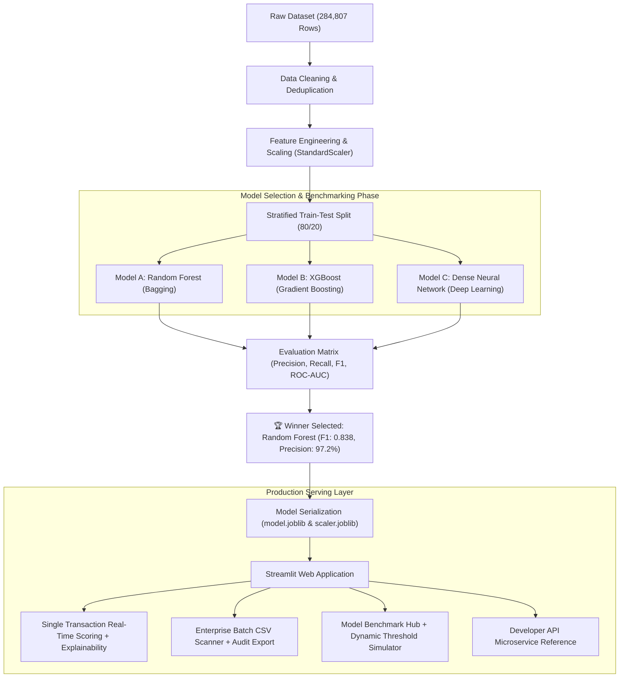

# 💳 SentinelGuard: End-to-End Credit Card Fraud Detection Engine

[](https://www.python.org/)
[](https://shivanshi-27-credit-card-fraud-detection-app-oq4h2h.streamlit.app/)
[](https://scikit-learn.org/)
[](https://xgboost.readthedocs.io/)
[](https://tensorflow.org/)
[](https://opensource.org/licenses/MIT)

An enterprise-ready Machine Learning system engineered to detect fraudulent credit card transactions in real-time. This project features a rigorous comparative benchmark across **Random Forest (Bagging)**, **XGBoost (Boosting)**, and a **Dense Neural Network (Deep Learning)** on an extremely imbalanced dataset (0.17% fraud rate), backed by an interactive **Streamlit** dashboard for instantaneous risk assessment, local feature explainability, and enterprise batch auditing.

## 🌐 Live Interactive Application
[](https://shivanshi-27-credit-card-fraud-detection-app-oq4h2h.streamlit.app/)

> 🚀 **Access the live dashboard directly:** [https://shivanshi-27-credit-card-fraud-detection-app-oq4h2h.streamlit.app/](https://shivanshi-27-credit-card-fraud-detection-app-oq4h2h.streamlit.app/)

---

## 📌 Executive Summary

Financial fraud incurs tens of billions of dollars in global annual losses. Detecting illicit transactions demands a delicate balance: maximizing the detection of subtle fraud patterns (**Recall**) while maintaining an exceptionally low false alarm rate (**Precision**) to prevent legitimate cardholders from having their cards unjustly blocked.

This repository implements a production-grade machine learning workflow:
* **Rigorous Preprocessing:** Deduplication, time-invariant feature selection, and robust monetary scaling.
* **Multi-Paradigm Benchmarking:** Head-to-head competition across three machine learning paradigms.
* **Feature Explainability:** Local feature impact breakdown illustrating why specific transactions are flagged.
* **Production Deployment:** Export of the winning model into a low-latency, interactive web application supporting single-transaction risk scoring, sample CSV template generation, and high-volume batch CSV audits.
* **Developer Integration:** Programmatic Python API snippets for embedding serialized models into backend microservices (FastAPI / Flask).

---

## 🏗️ System Architecture & Workflow



---

## 📊 Dataset & The Class Imbalance Dilemma

The system is trained on real-world European cardholder transactions sourced from [Kaggle](https://www.kaggle.com/datasets/mlg-ulb/creditcardfraud):

* **Total Transactions:** 284,807 transactions
* **Legitimate Transactions:** 284,315 (99.83%)
* **Fraudulent Transactions:** 492 (0.17%)
* **Features:** 28 anonymized PCA numerical components (`V1` to `V28`) + `Time` and `Amount`
* **Target:** `Class` (0 = Legitimate, 1 = Fraudulent)

> [!WARNING]  
> **The Accuracy Paradox:** In a dataset where 99.83% of transactions are legitimate, a completely naive model that classifies every single transaction as "Legitimate" would automatically achieve **99.83% accuracy** while catching exactly **zero frauds**. Therefore, **Precision**, **Recall**, and the **F1-Score** are our primary governing metrics.

---

## 🧪 Model Performance & Comparative Benchmark

Each model was trained on the identical 80% training partition and evaluated against the unseen 20% stratified test set:

| Model Paradigm | Algorithm | Accuracy | Precision | Recall | F1-Score | ROC-AUC | Primary Strength |
| :--- | :--- | :---: | :---: | :---: | :---: | :---: | :--- |
| **Bagging Ensemble** | 🏆 **Random Forest** | **0.9995** | **0.9722** | **0.7368** | **0.8383** | 0.9294 | **Lowest false positive rate; most dependable** |
| **Boosting Ensemble** | **XGBoost Classifier** | 0.9995 | 0.9459 | 0.7368 | 0.8284 | **0.9749** | **Highest discrimination capacity (ROC-AUC)** |
| **Deep Learning** | **Dense Neural Network** | 0.9994 | 0.8974 | 0.7368 | 0.8092 | 0.9659 | High recall capability, but higher false alarms |

### Why Random Forest Won the Production Deployment
1. **Highest Precision (97.22%):** When the model sounds the alarm, it is correct over 97 out of 100 times, avoiding costly customer friction.
2. **Top F1-Score (0.8383):** Delivers the strongest harmonic balance between precision and recall across all candidates.
3. **Low Latency & High Stability:** Tree ensembles on tabular features avoid the overhead and instability common in neural networks for structured financial data.

---

## 🖥️ Interactive Web Application Features

The accompanying Streamlit application provides a comprehensive operations cockpit for fraud investigation teams:

### 1. 🔍 Single Transaction Risk Scoring & Explainability
* **Preset Scenarios:** Instant pre-filling for Normal Purchase ($35.00), Suspicious Stolen Card Pattern ($1,850.50), and Borderline Anomaly ($420.00).
* **Local Feature Influence Chart:** Horizontal bar chart visualizing the push each feature (`V14`, `V4`, `V12`, `V10`, `Amount`) exerts towards Fraud vs. Legitimate status.
* **Advanced Feature Drawer:** Expandable section allowing granular inspection and fine-tuning across all 28 PCA dimensions.
* **3-Tier Decision Playbook:**
  * 🟢 **Low Risk (< 20%):** Approved immediately for frictionless checkout.
  * 🟡 **Medium Risk (20% - 50%):** Step-Up 2FA Challenge (OTP / Biometric prompt).
  * 🔴 **High Risk (> 50%):** Blocked transaction & automated cardholder freeze alert.

### 2. 📁 Enterprise Batch CSV Scanner
* **1-Click Sample CSV Generator:** Download a pre-formatted 5-record CSV template (`sample_transactions.csv`) containing both legitimate and fraudulent examples for immediate evaluation.
* **Financial Risk Metrics:** Instantly tallies Total Volume Audited ($) alongside **Capital at Risk Protected ($)**.
* **Full Audit Export:** Scored results can be exported as a stamped CSV report (`fraud_audit_report.csv`) for fraud operations logging.
* **Color-Coded Status Highlighting:** Clear visual demarcation between approved, challenged, and blocked records.

### 3. 📊 Benchmark Hub & Dynamic Threshold Simulator
* **Interactive Threshold Tuning:** Experiment with decision boundaries from 0.05 to 0.95 to inspect trade-offs between Catch Rate (Recall) and False Positive friction.
* **Financial Cost Matrix:** Explains asymmetric business impact:
  * *False Positive cost:* ~$2 - $5 (customer verification friction)
  * *False Negative cost:* ~$1,250 (unrecovered fraud loss + chargeback fines)

### 4. 🏛️ Developer API & Programmatic Usage
* Architecture diagram and step-by-step code sample for integrating serialized artifacts into backend microservices.

---

## 🐍 Programmatic Microservice Integration

You can integrate SentinelGuard directly into Python backend services (FastAPI, Flask, Django):

```python
import joblib
import pandas as pd

# 1. Load serialized production artifacts
model = joblib.load("model.joblib")
scaler = joblib.load("scaler.joblib")

# 2. Build incoming transaction vector
transaction = {f"V{i}": [0.0] for i in range(1, 29)}
transaction["V14"] = [-9.5]  # Critical anomaly indicator
transaction["V4"] = [6.2]
transaction["Amount"] = scaler.transform([[1850.50]])[0][0]

input_df = pd.DataFrame(transaction)

# 3. Predict fraud probability
fraud_probability = model.predict_proba(input_df)[0][1]
decision = "BLOCK" if fraud_probability > 0.50 else "2FA" if fraud_probability > 0.20 else "APPROVE"

print(f"Risk Score: {fraud_probability * 100:.2f}% | Decision: {decision}")
```

---

## 🚀 Getting Started

### Prerequisites
* Python 3.10, 3.11, 3.12, or 3.14
* Git

### Local Installation

```bash
# 1. Clone the repository
git clone https://github.com/SHIVANSHI-27/credit-card-fraud-detection.git
cd credit-card-fraud-detection

# 2. Create and activate a virtual environment
python -m venv venv
# On Windows:
venv\Scripts\activate
# On Linux/macOS:
source venv/bin/activate

# 3. Install required dependencies
pip install -r requirements.txt
```

### Running the Components

* **Launch the Interactive Web Application:**
  ```bash
  streamlit run app.py
  ```
  *The app will automatically open at `http://localhost:8501` in your browser.*

* **Execute the Multi-Model Training Pipeline:**
  ```bash
  python train_models.py
  ```

* **Interactive Exploration with Google Colab:**
  Upload `credit-card-fraud-detection-colab.ipynb` to Google Colab, enable T4 GPU acceleration, and run all cells for interactive visualizations.

---

## 📁 Repository Structure

```text
├── app.py                                  # Enhanced Streamlit web application & dashboard
├── train_models.py                         # Standalone multi-model benchmarking script
├── credit-card-fraud-detection-colab.ipynb # Jupyter notebook with EDA, visualizations & GPU training
├── requirements.txt                        # Production & training package dependencies
├── .gitignore                              # Git exclusion rules (dataset & environment artifacts)
├── model.joblib                            # Serialized Random Forest model artifact (~750 KB)
├── scaler.joblib                           # Serialized StandardScaler parameter artifact
└── readme.md                               # Comprehensive enterprise documentation
```

---

## 💡 Key Technical Takeaways for Interviews

* **Bagging vs. Boosting in Practice:** Random Forest builds 100 trees independently using bootstrap aggregation to minimize variance, making it resilient to tabular outliers. XGBoost builds trees sequentially to minimize residual loss, achieving a slightly higher ROC-AUC.
* **Tabular Data vs. Deep Learning:** While Neural Networks excel at unstructured vision and NLP tasks, tree ensembles consistently demonstrate superior performance, faster convergence, and greater interpretability on tabular numerical data.
* **Cost-Sensitive Decision Boundaries:** In real-world banking environments, decision thresholds are dynamically tuned depending on transaction volume, risk appetite, and historical merchant risk.

---

## 🙏 Acknowledgements, Provenance & Citations

This project builds upon open-source research and community contributions:

1. **Foundational Benchmark & Notebook:**
   * The initial comparative exploration across Random Forest, XGBoost, and Dense Neural Networks was originally authored by **[Axel Zaragoza](https://github.com/ax-zar/credit-card-fraud-detection)** in his Kaggle work [Credit Card Fraud Detection (RF, XGBoost, NN)](https://www.kaggle.com/code/axelzar/credit-card-fraud-detection-rf-xgb-nn).

2. **Dataset Citation:**
   * Sourced from the **Machine Learning Group (MLG)** at Université Libre de Bruxelles (ULB):
   * *Andrea Dal Pozzolo, Olivier Caelen, Reid A. Johnson, and Gianluca Bontempi. Calibrating Probability with Undersampling for Unbalanced Classification. In IEEE Symposium on Computational Intelligence and Data Mining (CIDM), 2015.* Available on [Kaggle](https://www.kaggle.com/datasets/mlg-ulb/creditcardfraud) under the Open Database License (ODbL).

3. **SentinelGuard Additions & Serving Implementation:**
   * The interactive Streamlit operations dashboard, real-time local feature explainability visualizer, batch CSV auditing engine, 1-click test sample generator, dynamic threshold simulator, financial risk metric tracking, and microservice integration endpoints were independently designed and developed by **[@SHIVANSHI-27](https://github.com/SHIVANSHI-27)**.

---

## 📄 License
This project is licensed under the MIT License - feel free to use and adapt it for academic, research, or commercial purposes.
