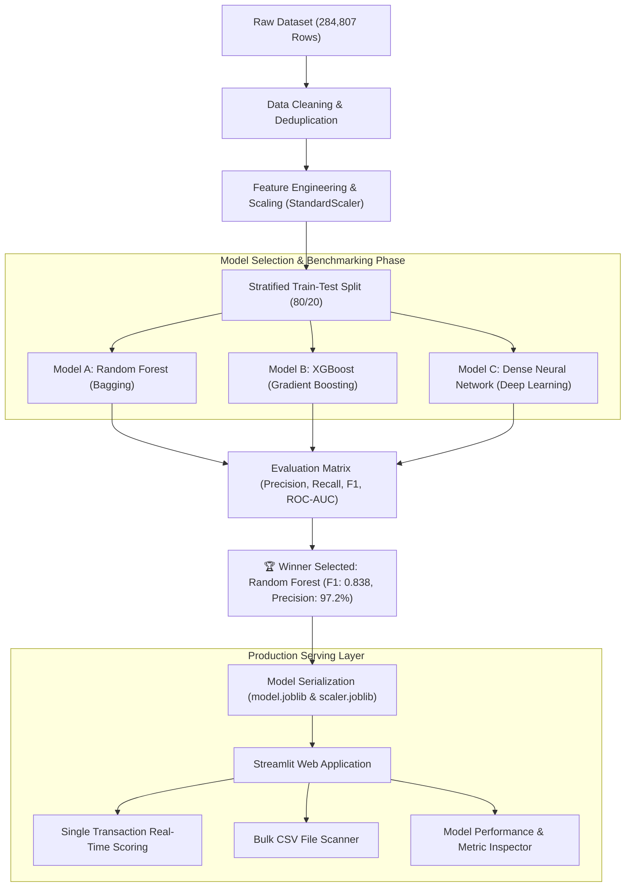

# 💳 SentinelGuard: End-to-End Credit Card Fraud Detection Engine

[](https://www.python.org/)
[](https://streamlit.io/)
[](https://scikit-learn.org/)
[](https://xgboost.readthedocs.io/)
[](https://tensorflow.org/)
[](https://opensource.org/licenses/MIT)

An enterprise-ready Machine Learning system engineered to detect fraudulent credit card transactions in real-time. This project features a rigorous comparative benchmark across **Random Forest (Bagging)**, **XGBoost (Boosting)**, and a **Dense Neural Network (Deep Learning)** on an extremely imbalanced dataset (0.17% fraud rate), backed by an interactive **Streamlit** dashboard for instantaneous risk assessment and batch enterprise auditing.

---

## 📌 Executive Summary

Financial fraud incurs tens of billions of dollars in global annual losses. Detecting illicit transactions demands a delicate balance: maximizing the detection of subtle fraud patterns (**Recall**) while maintaining an exceptionally low false alarm rate (**Precision**) to prevent legitimate cardholders from having their cards unjustly blocked.

This repository implements a production-grade machine learning workflow:
* **Rigorous Preprocessing:** Deduplication, time-invariant feature selection, and robust monetary scaling.
* **Multi-Paradigm Benchmarking:** Head-to-head competition across three machine learning paradigms.
* **Production Deployment:** Export of the winning model into a low-latency, interactive web application supporting single-transaction risk scoring and high-volume CSV audits.

---

## 🏗️ System Architecture & Workflow



---

## 📊 Dataset & The Class Imbalance Dilemma

The system is trained on real-world European cardholder transactions sourced from [Kaggle](https://www.kaggle.com/datasets/mlg-ulb/creditcardfraud):

* **Total Transactions:** 284,807 transactions
* **Legitimate Transactions:** 284,315 (99.83%)
* **Fraudulent Transactions:** 492 (0.17%)
* **Features:** 28 anonymized PCA numerical components (`V1` to `V28`) + `Time` and `Amount`
* **Target:** `Class` (0 = Legitimate, 1 = Fraudulent)

> [!WARNING]  
> **The Accuracy Paradox:** In a dataset where 99.83% of transactions are legitimate, a completely naive model that classifies every single transaction as "Legitimate" would automatically achieve **99.83% accuracy** while catching exactly **zero frauds**. Therefore, **Precision**, **Recall**, and the **F1-Score** are our primary governing metrics.

---

## 🧪 Model Performance & Comparative Benchmark

Each model was trained on the identical 80% training partition and evaluated against the unseen 20% stratified test set:

| Model Paradigm | Algorithm | Accuracy | Precision | Recall | F1-Score | ROC-AUC | Primary Strength |
| :--- | :--- | :---: | :---: | :---: | :---: | :---: | :--- |
| **Bagging Ensemble** | 🏆 **Random Forest** | **0.9995** | **0.9722** | **0.7368** | **0.8383** | 0.9294 | **Lowest false positive rate; most dependable** |
| **Boosting Ensemble** | **XGBoost Classifier** | 0.9995 | 0.9459 | 0.7368 | 0.8284 | **0.9749** | **Highest discrimination capacity (ROC-AUC)** |
| **Deep Learning** | **Dense Neural Network** | 0.9994 | 0.8974 | 0.7368 | 0.8092 | 0.9659 | High recall capability, but higher false alarms |

### Why Random Forest Won the Production Deployment
1. **Highest Precision (97.22%):** When the model sounds the alarm, it is correct over 97 out of 100 times, avoiding costly customer friction.
2. **Top F1-Score (0.8383):** Delivers the strongest harmonic balance between precision and recall across all candidates.
3. **Low Latency & High Stability:** Tree ensembles on tabular features avoid the overhead and instability common in neural networks for structured financial data.

---

## 🖥️ Interactive Web Application Features

The accompanying Streamlit application provides a full-featured user interface for fraud investigation teams:

1. **Single Transaction Risk Evaluator:**
   * Interactive sliders and numerical inputs for key risk drivers (`V14`, `V4`, `V10`, `Amount`).
   * One-click presets for **Typical Normal Transactions** and **High-Risk Fraud Scenarios**.
   * Real-time risk probability output with 3-tier severity categorization:
     * 🟢 **Low Risk (< 20%):** Approved immediately.
     * 🟡 **Medium Risk (20% - 50%):** Flagged for Step-Up / 2FA Verification.
     * 🔴 **High Risk (> 50%):** Blocked & escalated to Fraud Operations.

2. **Batch CSV Scanner:**
   * Drag-and-drop file uploader capable of processing large transaction batches.
   * Automated preprocessing, standardized scaling, and vector inference.
   * Color-coded summary table highlighting high-risk records and overall fraud frequency.

3. **Benchmarking & Inspection Hub:**
   * In-depth comparison matrix documenting accuracy, recall, and ROC-AUC.
   * Architectural workflow diagram explaining the production inference pipeline.

---

## 🚀 Getting Started

### Prerequisites
* Python 3.10, 3.11, or 3.12
* Git

### Local Installation

```bash
# 1. Clone the repository
git clone https://github.com/SHIVANSHI-27/credit-card-fraud-detection.git
cd credit-card-fraud-detection

# 2. Create and activate a virtual environment
python -m venv venv
# On Windows:
venv\Scripts\activate
# On Linux/macOS:
source venv/bin/activate

# 3. Install required dependencies
pip install -r requirements.txt
```

### Running the Components

* **Launch the Interactive Web Application:**
  ```bash
  streamlit run app.py
  ```
  *The app will automatically open at `http://localhost:8501` in your browser.*

* **Execute the Multi-Model Training Pipeline:**
  ```bash
  python train_models.py
  ```

* **Interactive Exploration with Google Colab:**
  Upload `credit-card-fraud-detection-colab.ipynb` to Google Colab, enable T4 GPU acceleration, and run all cells for interactive visualizations.

---

## 📁 Repository Structure

```text
├── app.py                                  # Production Streamlit web application
├── train_models.py                         # Standalone multi-model benchmarking script
├── credit-card-fraud-detection-colab.ipynb # Jupyter notebook with EDA, visualizations & GPU training
├── requirements.txt                        # Production & training package dependencies
├── .gitignore                              # Git exclusion rules (dataset & environment artifacts)
├── model.joblib                            # Serialized Random Forest model artifact
├── scaler.joblib                           # Serialized StandardScaler parameter artifact
└── readme.md                               # Comprehensive system documentation
```

---

## 💡 Key Technical Takeaways for Interviews

* **Bagging vs. Boosting in Practice:** Random Forest builds 100 trees independently using bootstrap aggregation to minimize variance, making it resilient to outliers. XGBoost builds trees sequentially to minimize residual loss, achieving a slightly higher ROC-AUC.
* **Tabular Data vs. Deep Learning:** While Neural Networks excel at unstructured vision and NLP tasks, tree ensembles consistently demonstrate superior performance, faster convergence, and greater interpretability on tabular numerical data.
* **Cost-Sensitive Decision Boundaries:** In real-world banking environments, decision thresholds are dynamically tuned depending on transaction volume, risk appetite, and historical merchant risk.

---

## 📄 License
This project is licensed under the MIT License - feel free to use and adapt it for academic, research, or commercial purposes.
